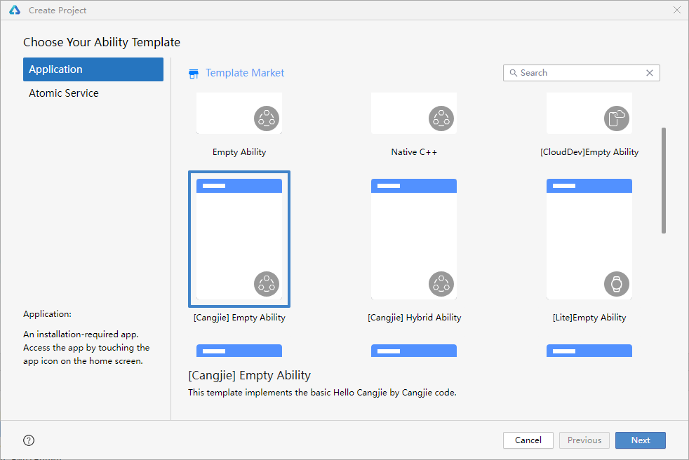
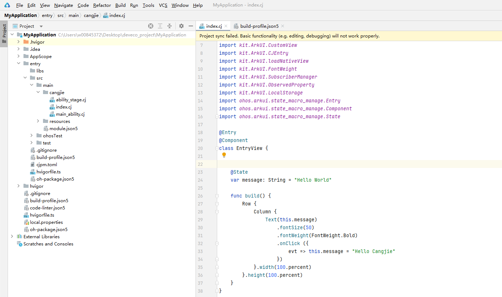

# 示例使用须知

## 概述

本文档为`仓颉原生示例转换为鸿蒙（HarmonyOS）示例`的专属使用须知。

本文档核心用途是为开发者提供清晰、可落地的转换操作指引，帮助开发者快速将已有的仓颉原生编程示例适配鸿蒙系统的开发规范、运行环境与 API 调用标准，顺利完成示例的迁移，最终实现示例在鸿蒙设备/模拟器上的正常运行。

[仓颉示例转鸿蒙示例](#仓颉示例转鸿蒙示例) 该内容展示了转鸿蒙时的注意要点。

[仓颉模板工程运行示例](#仓颉模板工程运行示例) 该内容展示了示例完整鸿蒙化的流程。

## 仓颉示例转鸿蒙示例

下方是非鸿蒙场景下的 API 示例，本手册示例均以如下形式呈现：

<!-- verify -->
```cangjie
import std.collection.ArrayList

main() {
    var arr = ArrayList<String>(["Hello", "Cangjie!"])
    println(arr) // Output: [Hello, Cangjie!]
}
```

转鸿蒙 ↓

**注意：**
>
> - 转鸿蒙时需注意！
> - 1.鸿蒙场景不支持 `main` 函数作为入口函数，需要改写成其他函数名。
> - 2.鸿蒙场景不支持在终端/控制台上直接 `print/println` 打印，可改写成 `Hilog.info` 形式。

```cangjie
import kit.PerformanceAnalysisKit.Hilog // Hilog.info 需要的导包
import std.collection.ArrayList

func test() { // 注意点 1
    var arr = ArrayList<String>(["Hello", "Cangjie!"])
    Hilog.info(0, "test", arr.toString()) // 注意点 2
}
```

## 仓颉模板工程运行示例

各仓颉示例，并非完整的鸿蒙程序，而是对应 API 的使用演示，仅供开发者参考。如果开发者希望编译运行代码，需要将示例拷贝到仓颉模板工程中。参考步骤如下：

1.创建一个仓颉模板工程。



2.创建完成后，会生成模板文件：“index.cj”、“main_ability.cj”、“ability_stage.cj”。



3.按如下示例，在对应位置添加鸿蒙化的示例代码。

```cangjie
// 此处导入所涉及的包，此处使用 6.0.2 版本
package ohos_app_cangjie_entry

internal import ohos.base.LengthProp
internal import ohos.component.Column
internal import ohos.component.Row
internal import ohos.component.Text
internal import ohos.component.CustomView
internal import ohos.component.CJEntry
internal import ohos.component.loadNativeView
internal import ohos.component.FontWeight
internal import ohos.state_manage.SubscriberManager
internal import ohos.state_manage.ObservedProperty
internal import ohos.state_manage.LocalStorage
import ohos.state_macro_manage.Entry
import ohos.state_macro_manage.Component
import ohos.state_macro_manage.State

import kit.PerformanceAnalysisKit.Hilog // Hilog.info 需要的导包
import std.collection.ArrayList

// 此处定义所需要的依赖项如 class、func 等，如下述示例中的 test 函数

func test() {
    var arr = ArrayList<String>(["Hello", "Cangjie!"])
    Hilog.info(0, "test", arr.toString())
}

@Entry
@Component
class EntryView {
    @State
    var message: String = "Hello World"

    func build() {
        Row {
            Column {
                Text(this.message)
                    .fontSize(50)
                    .fontWeight(FontWeight.Bold)
                    .onClick {
                        evt => test()
                    }
            }.width(100.percent)
        }.height(100.percent)
    }
}
```

## 权限说明

默认情况下，将仓颉原生示例转换为鸿蒙（HarmonyOS）示例后，应用可正常访问系统基础资源，无需额外申请权限，即可顺利运行示例核心功能。

仅当示例中涉及网络相关操作（如网络请求等）时，需申请对应网络权限，否则将导致网络相关功能无法正常使用。

需要权限：ohos.permission.INTERNET

权限配置方式：在“index.cj”、“main_ability.cj”、“ability_stage.cj”的上层目录中，找到“module.json5”文件，在文件的“module”键下添加“requestPermissions”配置，具体格式如下：

```text
{
  "module": {
    "name": "entry",
        ···省略其他...
    "requestPermissions": [
      {
        "name": "ohos.permission.INTERNET"
      }
    ]
        ···省略其他...
  }
}
```

完成权限配置后，即可正常使用示例中的网络相关功能。

除上述网络权限外，本示例其他所有功能均无需申请任何额外权限，无需进行多余的权限配置操作。
